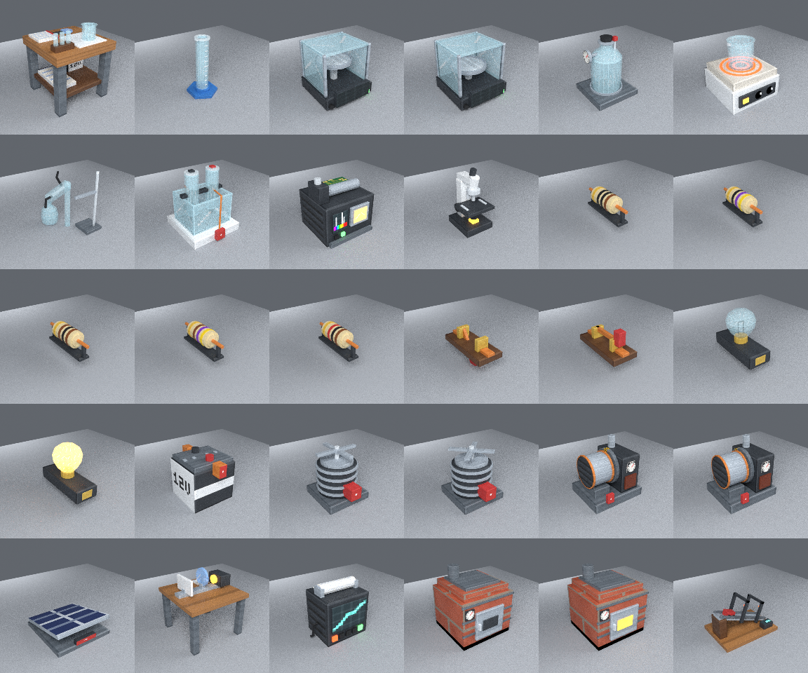

# Scientia — real science, playable in Minecraft

Scientia is a Minecraft **Forge 1.20.1** mod that turns the game into a scientific discovery sandbox.
You measure real quantities with real uncertainties, run experiments, record hypotheses, balance
chemical equations, build DC circuits that are actually solved with nodal analysis, watch water boil at
a temperature plateau, and earn research only through genuine accomplishments.

```
EXPLORE → COLLECT → OBSERVE → HYPOTHESISE → EXPERIMENT → MEASURE → CALCULATE → VERIFY → DISCOVER → BUILD → APPLY
```

| | |
|---|---|
| Minecraft | 1.20.1 |
| Mod loader | Forge 47.3.0 (ForgeGradle 6, official Mojang mappings) |
| Java | 17 (toolchain; Gradle downloads it if needed) |
| Build | Gradle 8.8 wrapper (`./gradlew`) |
| Mod id | `scientia` |



## What is in the mod

**Science engine** (`science-core/`, pure Java, no Minecraft dependency, 46 unit tests)
- Units and dimensional analysis (SI base dimensions, ~90 units, affine temperature scales).
- A safe calculator parser: arithmetic, powers, roots, logs, trig (RAD/DEG), factorials, percentages,
  scientific notation, constants (CODATA/SI 2019), units inside expressions (`12 g / 3 mL in g/cm3`,
  `25 degC in K`), fractions, significant figures and graceful errors. Nothing is ever executed as code.
- Chemistry: all 118 elements, a formula parser (brackets, hydrates, charges), 37 substances,
  14 balanced reactions with standard enthalpies computed from formation data, a reaction engine with
  limiting reagents, Faraday's law, gas solubility and escape, heat release; a pH solver based on the
  charge balance (strong acids/bases, acetate and carbonate systems, water autoionisation); indicators.
- Physics: DC circuit solver (nodal analysis with Norton-equivalent sources), lumped thermal model with
  latent heats and boiling-point elevation, kinematics on an incline with friction, thin lenses,
  Snell's law, dispersion (Cauchy), ideal gas law, electrochemistry.
- Research graph, experiment definitions, hypothesis evaluation that never mistakes noise for a change,
  and a persistent journal.
- A validator that checks every data file: balanced equations, mass conservation, dimensional
  consistency of every rearranged formula, research cycles, unknown references, missing explanations.

**In game** (Forge layer, `src/main/java/com/scientia/`)
- 21 blocks with Blender-generated OBJ models: Scientific Workbench, Precision Balance, Graduated
  Cylinder, Laboratory Heater, Condenser, Reaction Vessel, Material Analyzer (emission spectrometer +
  conductivity probe), Microscope, Data Recorder, Insulated Kiln, Optical Bench, Motion Track, Copper
  Wire, Battery, Resistor (colour-coded 10–1000 Ω), Circuit Switch (redstone-controllable), Filament
  Lamp, Electric Motor, Thermal Generator, Solar Panel, Electrolysis Station.
- 13 items: Science Journal, Scientific Calculator, Digital Thermometer, Multimeter, pH Meter, Beaker,
  Gas Canister, Mortar and Pestle and five 10 g reagents.
- Animated, state-driven renderers (generator rotor, motor fan, balance pan, heater coil glow, vessel
  stopper, liquid levels, distillate stream) and a contextual measurement HUD.
- Journal with research tree, interactive periodic table (Bohr-model view, filters, search), matter
  database, 23 experiments with hypotheses, data history and graphs, formula library, glossary, notes.
- Calculator, unit converter and formula solver screens; Optical Bench and Motion Track simulations.
- Server-authoritative gameplay: research, measurements and crafting are decided on the server.
- GameTests for the circuit, balance and conservation-of-mass loops.

See [docs/GAMEPLAY.md](docs/GAMEPLAY.md) for the first progression loop,
[docs/SCIENCE_NOTES.md](docs/SCIENCE_NOTES.md) for every scientific model, its sources and its
simplifications, and [docs/IMPLEMENTATION_REPORT.md](docs/IMPLEMENTATION_REPORT.md) for the status of
each system, what was verified and what was not.

## Building and running

Requires internet access to `maven.minecraftforge.net`, `piston-meta.mojang.com`,
`piston-data.mojang.com`, `libraries.minecraft.net`, `resources.download.minecraft.net`,
`services.gradle.org`, `plugins.gradle.org` and Maven Central.

```bash
./gradlew build                 # compiles the mod, runs the science-engine tests and asset validation
./gradlew runClient             # launches Minecraft with the mod
./gradlew runGameTestServer     # runs the in-world GameTests
./gradlew -p science-core test  # science engine only (no Minecraft download needed)
python3 tools/validate_assets.py
```

The built jar is `build/libs/scientia-0.1.0.jar`; put it in the `mods/` folder of a Forge 1.20.1
installation.

## Regenerating the assets

All machine models and textures are generated by Blender Python (`bpy`). From a clean checkout:

```bash
# Option A: with Blender installed
blender -b -P assets_source/blender/generate_all.py
# Option B: with the bpy module (Python 3.13, e.g. in a virtual environment)
pip install bpy==5.2.2
python assets_source/blender/generate_all.py            # add --no-render to skip the Cycles previews

python3 tools/gen_resources.py      # blockstates, item models, loot tables, tags, recipes, lang
python3 tools/validate_assets.py    # check everything is consistent
python3 tools/build_elements.py PeriodicTableJSON.json   # optional: rebuild elements.json (see docs)
```

The pipeline writes OBJ/MTL/JSON models to `src/main/resources/assets/scientia/models/block`, textures
to `.../textures`, preview renders to `assets_generated/previews` and a manifest (vertex counts, tiles,
animated part pivots) to `assets_generated/manifests/models.json`.

## Repository layout

```
science-core/                 pure-Java science engine + tests (also compiled into the mod)
src/main/java/com/scientia/   Forge layer: blocks, block entities, screens, renderers, networking, journal
src/main/resources/
  data/scientia/science/      elements, substances, reactions, materials, formulas, experiments,
                              research, glossary, spectra, microscope samples, workbench recipes
  assets/scientia/            generated models, textures, blockstates, lang
assets_source/blender/        procedural modelling toolkit (geometry, uv, textures, export, render)
assets_generated/             preview renders and manifests (committed for QA)
tools/                        resource generator, asset validator, element-table builder
docs/                         gameplay guide, scientific notes, implementation report
```

## Licence

MIT. Scientific values are facts taken from the references listed in `docs/SCIENCE_NOTES.md`; all
explanatory text is original.
